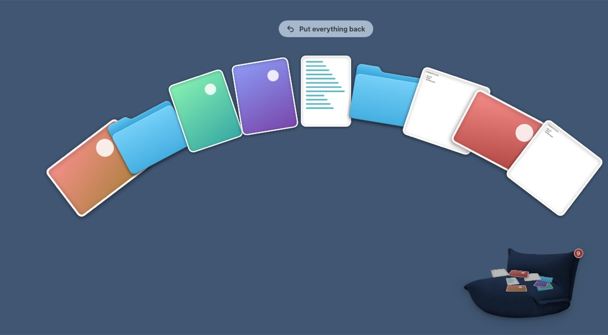

# Sofaonmac

An armchair for your Mac desktop. Drag files, folders, links or text onto it and they end up on the chair instead of cluttering the desktop. One click fans everything out, so you can open a file, put it back where it was, or drag it somewhere else.



- Nine seats to choose from, in three sizes that match the rugs of Rugonmac
- Everything stays in a normal folder, even while the app isn't running
- Lives in the menu bar and uses no CPU while idle
- In German when your Mac is set to German, in English otherwise

## Install

1. Download `Sofaonmac.zip` from [Releases](../../releases/latest) and unzip it.
2. Drag `Sofaonmac.app` into the Applications folder.
3. Run this once in Terminal, because the app isn't notarized:
   ```sh
   xattr -dr com.apple.quarantine /Applications/Sofaonmac.app
   ```
4. Open it.

Requires macOS 14 and a Mac with Apple silicon. Step by step: [Install.txt](Resources/Install.txt) ([Deutsch](Resources/Anleitung.txt)).

## Build

The Xcode Command Line Tools are enough.

```sh
scripts/build.sh --install        # build, copy to /Applications, start
scripts/package.sh                # dist/Sofaonmac.zip for sharing
scripts/add-sofa.sh <image> <id>  # cut out a new seat, then add it to SofaStyle.swift
```

Texts are written in English in the code; the German translations are in `Resources/de.lproj/Localizable.strings`.
